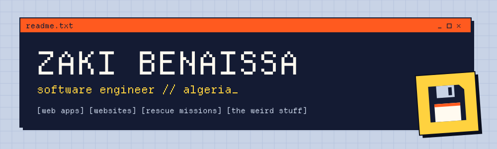

<a href="https://benaissazaki.space"></a>

## Hi, I'm Zaki 👋

I'm a freelance **software engineer** from Algeria 🇩🇿 with **6 years** of experience and a Master's degree. I build web apps, websites and the odd tool, and I care a lot about making them fast, secure and pleasant to maintain.

Off the clock I take things apart to see how they tick: game memory, media servers, microcontrollers. Then I write about it.

**[work with me →](https://www.linkedin.com/in/zaki-benaissa/)** · **[read the blog →](https://benaissazaki.space/blog/)**

## What I can do for you

- **`> web apps`**: custom back-ends and dashboards with Django, Laravel or Go, front-ends in React.
- **`> websites`**: WordPress sites that load fast, rank well and don't get hacked.
- **`> rescue missions`**: slow, broken or inherited codebase? I'll dig in, fix it and leave notes.
- **`> the weird stuff`**: CLIs, desktop tools, Flutter apps, Rust services, Godot games, reverse engineering old games, microcontrollers.

## Things I've built

- **[Palantir Media Server](https://github.com/benaissazaki/palantir-media-server)**: a tiny media server in Rust that streams my movie folder to every screen in the house. [Write-up here.](https://benaissazaki.space/blog/a-better-way-to-watch-movies-on-tv/) `rust` `networking`
- **[Django Course Sharing](https://github.com/benaissazaki/django_course_sharing)**: a web app for sharing PDF and video courses, with uploads, permissions and all the boring-but-important bits. `python` `django`
- **Mò 墨**: an Android app for learning Chinese characters, with animated stroke order and spaced repetition. I built it because every other app either skipped the strokes or hid them behind a paywall. `kotlin` `android`

## Toolbox

```text
languages      Python · JavaScript · PHP · Go · Rust
frameworks     Django · Laravel · React · Flutter · WordPress
data           PostgreSQL · MySQL
os             Arch Linux (btw)
anything else  give me a week (two if it's an undocumented esoteric language)
```

## Latest writing

- 🚀 [WordPress Speed Checklist](https://benaissazaki.space/blog/wordpress-speed-checklist/) · `2024-03-05`
- 🍡 [6 Django Tips to go From Beginner to Intermediate](https://benaissazaki.space/blog/django-from-beginner-to-intermediate/) · `2024-02-02`
- ☑️ [WordPress Security Checklist](https://benaissazaki.space/blog/wordpress-security-checklist/) · `2024-01-14`
- 📽️ [A better way to watch movies on TV](https://benaissazaki.space/blog/a-better-way-to-watch-movies-on-tv/) · `2023-06-18`

[all posts →](https://benaissazaki.space/blog/)

## Say hi

The fastest way to reach me is a message on [LinkedIn](https://www.linkedin.com/in/zaki-benaissa/). Everything else lives on [benaissazaki.space](https://benaissazaki.space).
